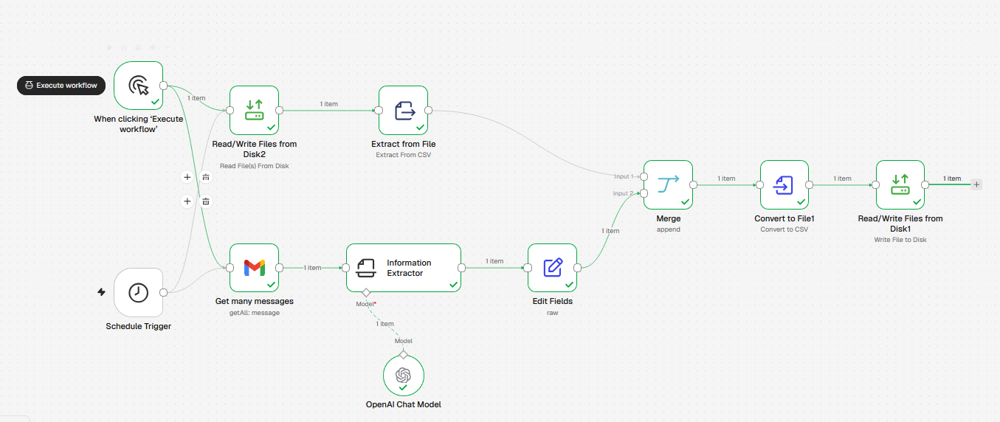

# parkrun-email-analytics

Self-hosted n8n Docker Compose setup with an example workflow for extracting parkrun results from emails using an LLM, and a Python Jupyter notebook for analysing the generated CSV data.

The parkrun app already shows these stats. This project is an ongoing experiment with AI workflows and n8n, so it hasn't been tested much or extended yet. It's a self-hosted internal deployment designed to run in a homelab, not a production or public-facing setup. It adds each week's result to the CSV, so after a few weeks there's enough data to make some graphs. It can also serve as a starting point for extracting stats from all historical parkrun emails, or anything else you want.

## How it works
Every Saturday at 14:00 (or when run manually), the workflow:
1. Fetches the latest parkrun results email from Gmail (`noreply@parkrun.com`, last 7 days)
2. Uses an OpenAI model to extract the results into structured fields
3. Appends them to `data/parkrun-results.csv`

The CSV columns are: `date`, `event`, `event_number`, `time`, `total_parkruns`, `event_parkruns`, `position`, `field_size`, `gender_position`, `age_category`, `age_category_position`, `event_pb`, `year_best`, `age_grade`.

## Setup
1. Copy the three example files (`.env.example`, `data/parkrun-results-example.csv` and `parkrun-analytics-example.ipynb`) to the same names without "example". The CSV must exist before starting n8n.
2. Start n8n with Docker Compose and visit it at your host's address on port 5678.
3. Set up your n8n owner account and password.
4. Import `parkrun_email_analytics.json` as a new workflow.
5. Add your OpenAI API and Gmail OAuth2 credentials to the OpenAI and Gmail nodes. For Gmail, enable the Gmail API in a Google Cloud project and create OAuth client credentials with the read-only Gmail scope, since the workflow only reads emails.
6. Test the workflow, then publish it to start the weekly trigger.

## Analysis
Open `parkrun-analytics.ipynb` in Jupyter or Google Colab and upload `parkrun-results.csv` alongside it to explore the results with pandas.

## To do
- Skip parkrun emails that aren't results, such as account preference updates
- Handle weeks with no run, so nothing is appended when there's no results email
- Avoid duplicate rows when the workflow is run more than once in a week
